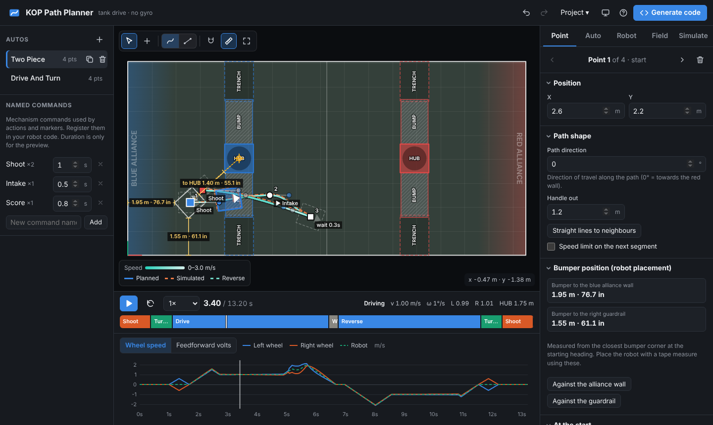

# KOP Path Planner

A web app that plans, simulates and **generates autonomous code** for the FRC Kit-of-Parts
chassis (AM14U-style tank / west coast drive). It works like PathPlanner, but it is built for a
plain KOP drivetrain and **does not need a gyroscope**. It runs with roboRIO encoders, motor
controller encoders, or no sensors at all.



## Features

- **Field editor**: draw paths with Bezier curves or "drive, stop, turn, drive" straight lines.
  Drag points and handles, double-click to insert, snap to grid, zoom and pan, undo/redo, and
  upload your own field image.
- **Stop points**: stop anywhere to turn in place, face a heading, **aim at a HUB**, drive
  backwards, or run a sequence of named commands and waits (e.g. *Shoot*, *Score*).
- **2026 field**: both **HUBs** (centers from the official 2026 AprilTag layout), the **BUMPs** on
  either side of them and the **TRENCHes**, all editable. The planner slows down on BUMPs, warns
  when the bumpers would hit a HUB (or a TRENCH for tall robots), and can place a shooting spot
  with the front bumper against the HUB.
- **Bumper position guides**: on-field measurements from the starting bumpers to the alliance
  wall and guardrail, and from the front bumper to the aimed HUB, so you can place the robot
  exactly where the plan starts.
- **Markers**: start commands while driving (e.g. *Intake*) at any point of the path.
- **Trajectory planning** for a differential drive: time-optimal velocity profile limited by max
  speed, acceleration, centripetal acceleration, per-wheel speed and per-segment speed limits.
  Includes turn-in-place profiles.
- **Simulation**: play the auto back with a timeline, a step bar and wheel speed / voltage
  charts. A **physics simulation of the generated controller** runs on an imperfect robot (weaker
  side, more friction, heavier or slower than planned, wheel scrub) so you can see how far the
  auto drifts without a gyro, and how much longer it takes.
- **Built for real KOP robots**: the generated follower waits for a robot that falls behind
  instead of cutting corners, pushes through static friction and tread scrub at the end of each
  step, holds heading against a weaker side, and stops trusting an encoder that reads backwards or
  not at all (no runaway). Calibration autos measure kS/kV, wheel diameter and track width.
- **Checks**: auto period overrun, bumpers leaving the field or hitting a HUB, turning on a BUMP,
  voltage saturation, sharp corners.
- **Code generation** for **Java (WPILib command-based)** and **Python (RobotPy commands2)**:
  a drivetrain subsystem, a gyro-less trajectory follower, a named-command registry,
  calibration autos and one method per auto. Download everything as a `.zip`.
- **Hardware** supported out of the box: Talon SRX / Victor SPX (CAN, Phoenix 5), **SPARK MAX +
  NEO** and **SPARK Flex + NEO Vortex** (REVLib 2026, built-in encoders with a shortened velocity
  filter), SPARK MAX brushed (CIM), and PWM SPARK MAX / Victor SPX / Talon SRX / SPARK / Victor SP.
  Encoders: none, roboRIO DIO quadrature, or through the motor controller. One-click drivetrain
  presets set motors, controllers, encoders and estimated kV/kA together.
- Projects autosave in the browser and can be saved/opened as files. PathPlanner `.path` files
  can be imported.
- **Saved robot configs**: keep the robot settings (drivetrain, IDs, gains, calibration and
  code options) under a name, such as *Comp bot* and *Practice bot*, and load them into any
  project. Configs live in the browser and download as `.robot.json` files to move to another
  laptop or share with the team (Robot tab, or Project → Save / Load robot config file). A
  project file can be loaded as a robot config too.
- **Calm, low-glare interface**: flat surfaces, no glows or gradients, muted field colors and a
  soft dark mode (follows the system or pick one). Both side panels collapse to give the field
  the whole window, and the speed chart can be hidden.
- **Built to survive mistakes**: every area has its own error boundary with a one-click project
  backup, a planning error shows a banner instead of a blank screen, Esc cancels a drag, deleting
  asks first (and undo brings it back), invalid numbers are flagged without touching the robot,
  and the project is saved again when the tab is hidden or closed. Dialogs, menus and tabs work
  with the keyboard.

## Getting started

Use the hosted version (GitHub Pages, deployed from `main`), or run it locally:

```bash
npm ci
npm run dev      # http://localhost:5173
```

`npm run build` produces a static site in `dist/` that works from any web server or sub-path.

### Workflow

1. **Robot tab**: pick a drivetrain preset (e.g. *2 NEO / side · SPARK MAX*), then check gear
   ratio, wheel size, motor controller IDs, encoders and gains. The defaults are a stock KOP
   chassis: Toughbox Mini 10.71:1, 6" wheels, 2 CIMs per side, Talon SRX + Victor SPX, E4T
   encoders on the roboRIO. Once it is set up and calibrated, save it under **Saved robot
   configs** so every new project can load it.
   **Field tab**: the 2026 field with its HUBs, BUMPs and TRENCHes, or your own field image.
2. **Draw** the path with the **+** tool. Curve mode gives smooth paths; line mode gives
   "drive, stop, turn in place, drive", the most predictable option without a gyro.
3. **Select a point** to edit it: stop or drive through, direction, handle lengths, drive
   backwards, face a heading or aim at a HUB, actions and markers. The first point shows the
   bumper distances to the alliance wall and guardrail for placing the robot.
4. **Play** the auto and check the Auto tab for warnings. On the **Simulate** tab, add
   imperfections and watch the orange dashed robot.
5. **Generate code**, download the zip, and copy it into your robot project. The included
   `KOP_AUTOS_README.md` shows the few lines to add to `RobotContainer` / `robot.py`:

```java
KopNamedCommands.register("Shoot", () -> shooter.shootCommand());   // before building autos
autoChooser = KopAutos.buildChooser(drive);                          // drive = new KopDrivetrain()
SmartDashboard.putData("Auto", autoChooser);
```

## How it works without a gyro

On a tank drive the heading is fixed by the *difference* in distance travelled by the left and
right wheels. The planner converts the path into a position / velocity / acceleration profile for
**each wheel**. If both wheels follow their profiles, the robot follows the path, with no
heading sensor involved.

| Mode | What the generated follower does |
| --- | --- |
| **No encoders** | Plays back per-wheel feedforward voltages (kS + kV·v + kA·a) by time. Simple; drift grows with path length. |
| **Encoders** | Feedforward plus per-wheel position/velocity feedback, heading hold on the left/right error difference (with an integral, so a weaker side does not leave a steady heading error), and path correction from encoder-only odometry (steers back when the robot drifts sideways). |

With encoders the follower is built for what a real KOP chassis does:

- **Progress clock.** Setpoints advance on a clock that slows down and stops when a wheel falls
  behind (heavier or slower than planned, low battery, tread scrub). Both wheels share the clock,
  so the robot keeps the path's shape and takes longer instead of cutting corners. Markers trigger
  on this progress, not on wall time, so they stay at their place on the path.
- **Voltage limiting** scales both sides together, keeping the turn ratio.
- **Settling.** A step ends when the distance is within tolerance, the heading within 0.75° and
  both wheels are slow. A wheel stuck short of its target (static friction, scrub on a turn in
  place) gets extra voltage until it moves.
- **Encoder checks.** A side that moves the wrong way, or does not count while the other one
  does, stops the closed loop before the robot runs away. The auto finishes open loop and the
  Driver Station says which constant to flip.
- **Planning headroom.** The planner keeps the feedforward 2 V under the voltage limit, so the
  feedback has room to correct and a sagging battery does not saturate the motors.

The only error encoders cannot see is wheel slip and scrub. The generated **calibration autos**
(in the auto chooser) fix the rest on the real robot: *Test: measure feedforward* fits kS and kV,
*Test: drive 2 m* checks the wheel diameter and *Test: turn 360°* the effective track width. The
**Estimate kV/kA** button gives a physics-based starting point until then.

Enter what the robot really did in the **Calibration** section of the Robot tab: how far it drove,
and whether the turn stopped short of the start line or went past it. The two tests depend on
each other (the turn is measured with the wheel diameter the code was generated with), so the
planner corrects the wheel diameter, the track width and kV/kA together from one run of both
tests. Fixing them one at a time from the same run, or reading the turn the wrong way round,
leaves them off or makes them worse. After applying, generate and deploy the code before testing
again.

## Generated code

| Java (`src/main/java/frc/robot/kop/`) | Python (`kop/`) | Purpose |
| --- | --- | --- |
| `KopDriveConstants.java` | `constants.py` | Measurements, IDs, gains |
| `KopDrive.java` | — (duck typing) | Interface the autos drive through |
| `KopDrivetrain.java` | `drive.py` | Ready-made drivetrain subsystem with teleop arcade drive and encoder odometry |
| `KopTrajectory.java` | `trajectory.py` | Sampled wheel trajectories with interpolation |
| `FollowKopTrajectory.java` | `follow.py` | Gyro-less trajectory follower command |
| `KopNamedCommands.java` | `named_commands.py` | Registry for action/marker commands |
| `KopAutos.java` | `autos.py`, `auto_data.py` | One command per auto, plus `buildChooser` |
| `KopCalibration.java` | `calibration.py` | Calibration autos: measure feedforward, drive 2 m, turn 360° |

Every auto can be **mirrored at runtime** (`KopAutos.myAuto(drive, () -> mirror)`), which swaps
left and right turns to run the same routine from the other side of the field. Trajectories are
embedded in the source code, so there are no deploy files to forget.

## Development

```bash
npm run dev             # dev server
npm run typecheck       # TypeScript
npm test                # planner, simulator, codegen and editor unit tests (Vitest)
npm run test:e2e        # browser tests of the editor, dialogs and layout (Playwright, Chromium)
npm run build           # production build
npm run verify:codegen  # end-to-end check of the generated robot code (see below)
```

`npm run verify:codegen` (`tools/verify/run.sh`) generates code for every controller/encoder
combination, then:

- compiles every Java variant with `javac --release 17 -Werror` against API stubs of WPILib,
  Phoenix 5 and REVLib (`tools/verify/java-stubs`);
- runs the generated `FollowKopTrajectory` against drivetrain plants that do not match the
  constants (weaker side, heavier and slower, tread scrub) and one with an encoder wired
  backwards, which must be caught without a runaway;
- constructs every Python variant with the real **RobotPy 2026** and vendor libraries, and
  runs whole autos, the calibration autos and an encoder fault in the RobotPy simulator,
  checking the commands ran, where the robot stopped and that the feedforward test measures
  the plant's kS and kV.

It needs a JDK and `pip install -r tools/verify/requirements.txt`. CI runs it on every pull
request, together with the unit and browser tests. Before the first `npm run test:e2e`, run
`npx playwright install chromium` once.

```
src/
  model/      data types, defaults, store (undo/redo, autosave), editing operations
  planner/    geometry, trajectory generation, follower physics simulation
  codegen/    Java + Python generators, zip writer
  styles/     design tokens (light/dark), base, component and layout CSS
  ui/
    components/  shared building blocks: modal, menu, tabs, confirm, toasts, error boundary, fields
    field/       field canvas (interaction) and its renderer
    hooks/       planning, playback, keyboard shortcuts, theme
    layout/      header, autos sidebar, inspector
    panels/      Point, Auto, Robot, Field and Simulate tabs
    timeline/    playback bar, step bar and speed/voltage chart
    modals/      generated code and help dialogs
tests/        Vitest unit tests
e2e/          Playwright browser tests
tools/verify/ generated-code verification (javac stubs, Java harness, RobotPy simulation)
```

## Notes and limitations

- Paths are relative to the starting pose. Place the robot where the plan starts, facing the
  planned heading. Field position only matters for the preview.
- Vendor APIs change between seasons. The generated CAN code targets Phoenix 5 and REVLib 2026;
  vendor-specific lines are isolated in `KopDrivetrain` / `drive.py` and marked.
- Brushed SPARK MAX controllers have no built-in encoder: use roboRIO encoders or open loop.
- Two markers that require the same subsystem cannot run in the same segment (WPILib parallel
  group rule).

## License

[MIT](LICENSE)
